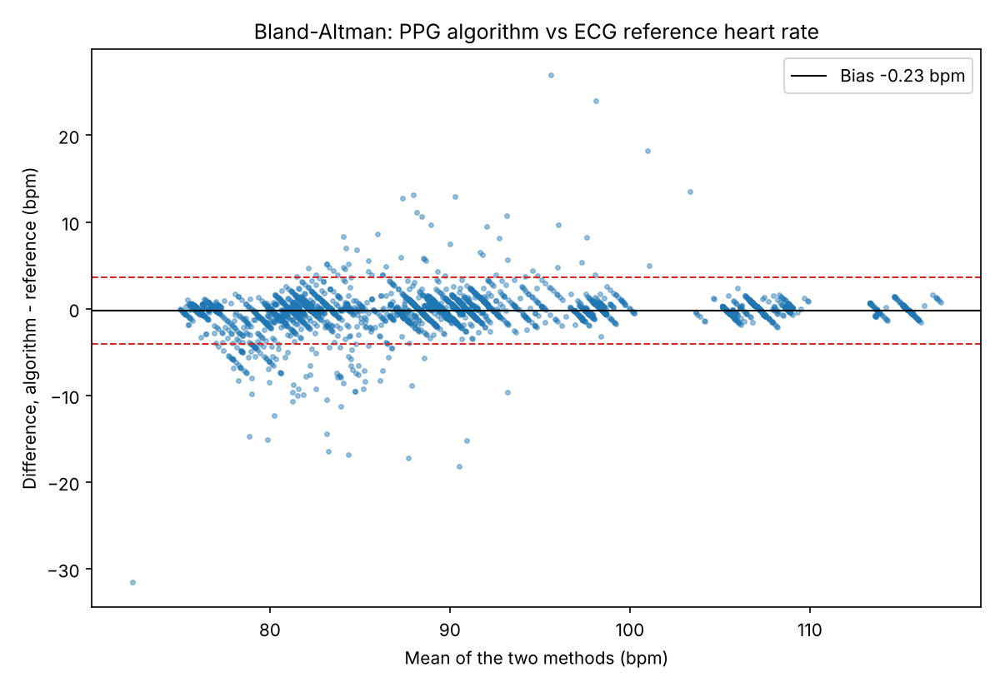
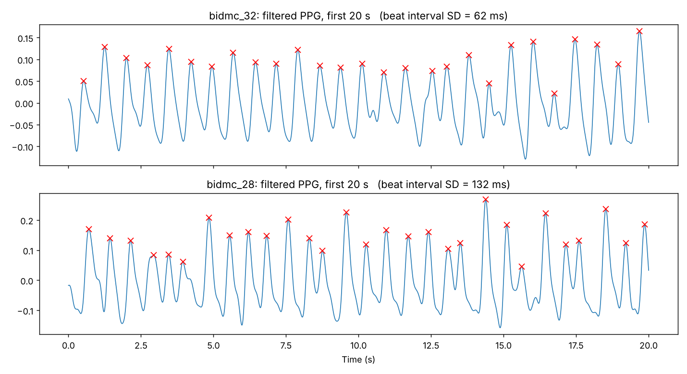

# PPG Heart Rate Analysis

I first built a heart rate monitor from an STM32F103C8T6 and a MAX30102 red/IR optical sensor, with an OLED screen to show the reading live. The heart rate came from the sensor's built-in algorithm, so I didn't really know how the number was produced.

This repository is the follow-up: estimating heart rate from the raw PPG signal myself in Python, and checking the result against ECG-measured heart rate on real ICU recordings from the [BIDMC PPG and Respiration Dataset](https://physionet.org/content/bidmc/1.0.0/).

## How it works

1. **Band-pass filter (0.5–4 Hz).** Heart rate between 30 and 240 bpm sits in this band. Anything slower is mostly breathing, movement or finger-pressure drift; anything faster is noise. The filter runs forwards and backwards (`filtfilt`) so the peaks are not shifted in time.
2. **Peak detection.** Each systolic peak is one heartbeat. Two rules stop false beats: peaks must be at least 0.3 s apart (max 200 bpm) and must stand out from the signal by a minimum prominence, which keeps the dicrotic notch from being counted.
3. **Heart rate per window.** Beat-to-beat intervals are converted to bpm, and each window uses the median, so one missed or extra beat doesn't drag the result.
4. **FFT as a cross-check.** The strongest frequency in the 0.5–4 Hz band, converted to bpm.
5. **Comparison** with the monitor's ECG-derived heart rate over the same window.

The core functions are in [`python/ppg.py`](python/ppg.py); the evaluation is in [`python/bidmc_analyze.py`](python/bidmc_analyze.py).

## Results

17 recordings (about 8 minutes each, 125 Hz), windows sliding every 2 s.

| Window | Method | Mean abs. error | Windows within 5 bpm |
|---|---|---|---|
| 10 s | Peak detection | 0.99 bpm | 97.0% |
| 10 s | FFT | 2.44 bpm | 96.0% |
| 20 s | Peak detection | 0.72 bpm | 98.5% |
| 20 s | FFT | 1.36 bpm | 97.5% |



## What I found

- **Window length is a trade-off.** 20 s windows were more accurate for both methods. For FFT this is mostly resolution: a 10 s window can only resolve 0.1 Hz (6 bpm), a 20 s window 0.05 Hz (3 bpm). Peak detection also improved because a longer window holds about twice as many beats, so the median is steadier. The cost is speed: if heart rate jumps suddenly, a 20 s window takes twice as long to show it, which matters in an ICU.
- **The worst recording had an irregular rhythm.** bidmc_28 had the largest error (4.4 bpm with 10 s windows). Its beat-to-beat intervals vary much more than the others: a standard deviation of 140 ms, against a median of 42 ms for the other 16 recordings. When beats are this uneven, a median over the window and the monitor's averaged reading drift apart, and smaller peaks are easier to miss. From the PPG alone I can't tell whether this is an arrhythmia or measurement noise.



- **A bug worth remembering.** My first run gave an FFT error of about 18 bpm. The sampling rate had been estimated as 100 Hz instead of 125 Hz, because the CSV timestamps are rounded and the median gap between them was biased. Every FFT frequency was scaled by 0.8. Calculating the rate from the whole recording fixed it.

## Run it

```bash
pip install -r requirements.txt
cd python
python download_bidmc.py                 # downloads the CSV files from PhysioNet
python bidmc_analyze.py                  # 10 s windows (default)
python bidmc_analyze.py --window 20 --out ../results/window_20s
python bidmc_analyze.py --example 28     # plot one recording with detected beats
```

## Next steps

- Run it on all 53 recordings
- Skip windows with poor signal quality instead of forcing an estimate
- Use the red/IR ratio to estimate SpO2
- Move the algorithm back onto the STM32 so it runs in real time

## Data

BIDMC PPG and Respiration Dataset v1.0.0, PhysioNet, Open Data Commons Attribution License v1.0.
Pimentel, M.A.F. et al. *Toward a Robust Estimation of Respiratory Rate From Pulse Oximeters.* IEEE Transactions on Biomedical Engineering, 64(8), 2016. doi:10.1109/TBME.2016.2613124
